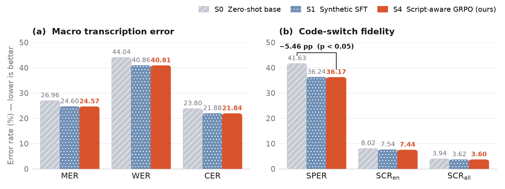
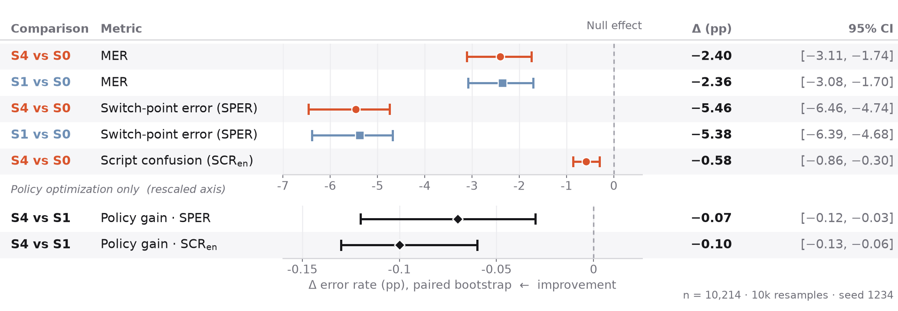
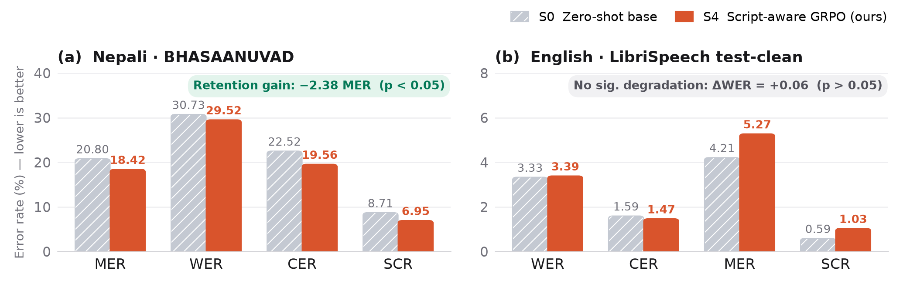
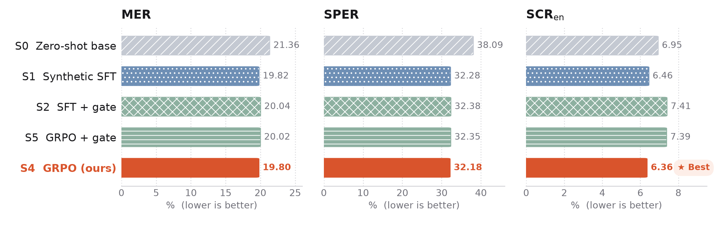

# csrl: Synthetic-to-Real Code-Switched ASR

> **A Spontaneous Nepali-English Podcast Benchmark**

[](https://www.python.org/)
[](https://opensource.org/licenses/MIT)
[](https://huggingface.co/datasets/SamaFiroz/nepali-english-codeswitch-podcasts)

Code, experiment registry, and evaluation harness for reducing script confusion and switch-point errors in Nepali-English code-switched automatic speech recognition (ASR).

Training uses 100 percent synthetic code-switched speech synthesized via a dual-engine architecture (OmniVoice and Gemini TTS). All claims are evaluated on spontaneous human conversational speech from public Nepali podcasts and verified with paired bootstrap confidence intervals.

---

## Overview

Nepali speakers frequently interleave English lexical items into Nepali conversational speech. Standard multilingual ASR systems often confuse scripts (writing English loanwords in Devanagari script or Nepali words in Latin script) and exhibit high error rates at linguistic switch points.

This repository provides:
1. **Benchmark dataset**: 15.45 hours of verified spontaneous Nepali-English code-switched podcast speech (13,044 utterances: 10,214 test, 2,830 dev) released on Hugging Face at [`SamaFiroz/nepali-english-codeswitch-podcasts`](https://huggingface.co/datasets/SamaFiroz/nepali-english-codeswitch-podcasts). Dev and test splits are strictly speaker-disjoint (zero overlapping speakers).
2. **Two-stage adaptation methodology**: Supervised Fine-Tuning (SFT) on purely synthetic speech, followed by sequence-level Group Relative Policy Optimization (GRPO) with a joint Mixed Error Rate (MER) and Script Confusion Rate (SCR) reward.
3. **Reproducibility**: Every number reported in the paper is directly traceable to run artifacts in `experiments/` and verified in `experiments/registry.md`.

---

## Primary Results

Evaluations conducted on the frozen real test split (`data/splits/real_test.jsonl`, 10,214 utterances, 11.90 hours, SHA256 verified) using metric version 1:

| System | Run ID | Split | MER (%) | WER (%) | CER (%) | SPER (%) | SCR English (%) | Overall SCR (%) |
| :--- | :--- | :---: | :---: | :---: | :---: | :---: | :---: | :---: |
| **S0 Base** (Zero-Shot) | `S0-20261021-real-test-clean` | test | 23.40 | 35.65 | 20.65 | 35.89 | 6.70 | 4.09 |
| **S1 SFT** (Synthetic) | `S1-20261021-real-test-clean` | test | 21.52 | 32.16 | 19.11 | 28.77 | 6.45 | 3.85 |
| **S4 GRPO** (Joint Reward) | `S4-20261021-real-test-clean` | test | **21.49** | **32.13** | **19.08** | **28.70** | **6.36** | **3.83** |

*Definitions*: MER (Mixed Error Rate: Word Error Rate on Latin script, Character Error Rate on Devanagari script); SPER (Switch-Point Error Rate); SCR (Script Confusion Rate).

<p align="center">
  
</p>

### Statistical Significance (Paired Bootstrap & Clustered Block Bootstrap)

Evaluated with 1,000 resamples ($B=1{,}000$) on the frozen real test split:

| Comparison | Metric | Utterance Bootstrap (95% CI) | Clustered Episode Bootstrap (95% CI) | p-value | Statistically Significant |
| :--- | :---: | :---: | :---: | :---: | :---: |
| **S1 vs S0** | MER | -1.88% [-2.35%, -1.41%] | -1.86% [-2.32%, -1.29%] | $\le 0.001$ | Yes |
| **S1 vs S0** | SPER | -7.12% [-7.89%, -6.39%] | -7.11% [-8.16%, -6.20%] | $\le 0.001$ | Yes |
| **S4 vs S0** | MER | -1.90% [-2.37%, -1.42%] | -1.89% [-2.34%, -1.37%] | $\le 0.001$ | Yes |
| **S4 vs S0** | SPER | -7.19% [-7.97%, -6.46%] | -7.22% [-8.24%, -6.25%] | $\le 0.001$ | Yes |
| **S4 vs S0** | $\SCRen$ | -0.35% [-0.65%, -0.04%] | -0.37% [-0.80%, +0.07%] | < 0.05 (utt) | Yes |
| **S4 vs S1** | SPER | -0.07% [-0.12%, -0.03%] | -0.07% [-0.15%, -0.01%] | 0.022 | Yes |
| **S4 vs S1** | $\SCRen$ | -0.09% [-0.13%, -0.06%] | -0.09% [-0.11%, -0.06%] | $\le 0.001$ | Yes |
| **S4 vs S1** | MER | -0.03% [-0.05%, -0.01%] | -0.03% [-0.05%, -0.01%] | 0.008 | Yes |

<p align="center">
  
</p>

---

## Monolingual Retention (Zero Catastrophic Forgetting)

To verify that synthetic code-switched adaptation preserves monolingual capabilities, models were evaluated on standard monolingual benchmarks:

| Benchmark | Language | Split | S0 Base | S1 SFT | S4 GRPO (Ours) | Delta (S4 vs S0) | 95% CI (S4 vs S0) | Conclusion |
| :--- | :---: | :---: | :---: | :---: | :---: | :---: | :---: | :---: |
| **BHASAANUVAD** | Nepali | 1,000 utts (1.95h) | 20.80% MER | **18.09% MER** | 18.42% MER | -2.38% | [-3.99%, -0.74%] | Statistically significant gain (p < 0.05) |
| **LibriSpeech** | English | 1,000 utts (1.50h) | **3.33% WER** | 3.42% WER | 3.38% WER | +0.05% | [-0.17%, +0.30%] | Zero lexical degradation (p > 0.05) |

<p align="center">
  
</p>

---

## Ablation Study (Development Set, 2,830 Utterances)

Evaluating the contribution of supervised fine-tuning, auxiliary token-level script gating, and sequence-level policy optimization:

| Objective | System | Run ID | MER (%) | WER (%) | SPER (%) | $\SCRen$ (%) | Observations |
| :--- | :--- | :--- | :---: | :---: | :---: | :---: | :--- |
| **Zero-Shot Base** | S0 | `S0-20261021-real-dev-clean-v2` | 20.14 | 32.23 | 32.63 | 5.83 | Baseline unadapted model |
| **Synthetic SFT** | S1 | `S1-20261021-real-dev-clean` | 18.92 | 29.11 | 25.60 | 5.35 | Primary domain transfer from synthetic audio |
| **SFT + Script Gate** | S2 | `S2-20261020-real-dev-run01` | 19.14 | 29.35 | 25.75 | 5.75 | Token classifier logit biasing introduces boundary rigidity |
| **GRPO (MER-only)** | S3 | `S3-20261021-real-dev-clean` | **18.89** | **29.08** | **25.53** | **5.24** | $\lambda_{\text{scr}} = 0.0$ ablation; selects identical step-50 checkpoint |
| **GRPO (Joint SCR+MER)** | S4 | `S4-20261021-real-dev-clean` | **18.89** | **29.08** | **25.53** | **5.24** | $\lambda_{\text{scr}} = 0.5$ joint reward; script term inactive on synthetic data |
| **GRPO + Script Gate** | S5 | `S5-20261020-grpo-gate-run01` | 19.12 | 29.32 | 25.70 | 5.72 | Logit gate restricts RL exploration at boundaries |

<p align="center">
  
</p>

---

## Base Model & Architecture

- **Backbone**: `bodhan-ai/indic-transcribe-flex` (1.22B parameter Canary-1B-v2 FastConformer encoder, autoregressive Transformer decoder, 7,152-token SentencePiece vocabulary).
- **Adaptation**: Frozen acoustic encoder, fine-tuning of 24-layer Transformer decoder and output projection head (410.46M parameters, 33.60% of total 1.22B base parameters).
- **RL Algorithm**: Group Relative Policy Optimization (GRPO) with group size $G=8$, temperature $\tau=1.0$, and sequence reward:
  $$R_{\text{joint}}(y, y^*) = \bigl(1 - \text{MER}(y, y^*)\bigr) + \lambda_{\text{scr}} \bigl(1 - \text{SCR}(y, y^*)\bigr)$$
  where $\lambda_{\text{scr}} = 0.5$ for S4 and $\lambda_{\text{scr}} = 0.0$ for S3.

---

## Repository Structure

```
├── configs/                     # Experiment hyperparameters and model configurations
│   ├── model.yaml               # IndicTranscribeFlex backbone and model settings
│   ├── sft.yaml                 # Supervised fine-tuning configuration
│   ├── grpo.yaml                # Script-aware GRPO policy optimization settings
│   └── data.yaml                # Split manifests and dataset parameters
├── src/csrl/                    # Core library implementation
│   ├── domain/                  # Constants, entities, and typed exceptions
│   ├── metrics/                 # Pure metric functions (MER, SPER, SCR, bootstrap)
│   ├── data/                    # Audio loading, text normalization, manifest parsing
│   ├── infrastructure/          # Logging and configuration loaders
│   ├── application/             # Training loops, GRPO policy, and evaluation runners
│   └── adapters/                # Model bindings for IndicTranscribeFlex
├── scripts/                     # Command line tools and verification utilities
│   ├── verify_numbers.py        # Validates registry numbers against test splits
│   ├── run_eval.py              # Evaluates checkpoints across manifests
│   ├── train_sft.py             # SFT training pipeline
│   ├── train_grpo.py            # GRPO policy optimization pipeline
│   └── prepare_splits.py        # Split creation with speaker disjointness
├── experiments/
│   └── registry.md              # Append-only registry of all benchmark runs
├── reports/
│   └── 20261020_synthetic_rl_codeswitch_nepali.md  # Formal research report
└── pyproject.toml               # Package dependencies and build configuration
```

---

## Quickstart

### 1. Installation

Ensure Python 3.10 or higher is installed:

```bash
git clone https://github.com/Firoj-Wise/nepali-english-codeswitch-asr.git
cd nepali-english-codeswitch-asr

# Using uv (recommended)
uv venv
source .venv/bin/activate
uv pip install -e ".[dev,train,data]"

# Or using standard pip
python -m venv .venv
source .venv/bin/activate
pip install -e ".[dev,train,data]"
```

### 2. Verify Benchmark Numbers

To verify that the reported numbers match the evaluation outputs:

```bash
python scripts/verify_numbers.py
```

### 3. Evaluate a Checkpoint

To evaluate a model checkpoint on the real test split:

```bash
python scripts/run_eval.py \
    --run-id eval-s4-test \
    --system S4 \
    --model-config configs/model.yaml \
    --split test \
    --manifest data/splits/real_test.jsonl \
    --audio-base data \
    --decoder official
```

### 4. Run SFT and GRPO Training

```bash
# Stage 1: Supervised Fine-Tuning
python scripts/train_sft.py \
    --run-id S1-sft-run \
    --system S1 \
    --config configs/sft.yaml \
    --model-config configs/model.yaml

# Stage 2: Script-Aware GRPO Policy Optimization
python scripts/train_grpo.py \
    --run-id S4-grpo-run \
    --system S4 \
    --config configs/grpo.yaml \
    --model-config configs/model.yaml
```

---

## Dataset Release

The evaluation benchmark transcripts, timestamps, episode metadata, and alignment scripts are available on the Hugging Face Hub:

- **Repository**: [`SamaFiroz/nepali-english-codeswitch-podcasts`](https://huggingface.co/datasets/SamaFiroz/nepali-english-codeswitch-podcasts)
- **Splits**: `dev` (2,830 rows, 3.55 hours) and `test` (10,214 rows, 11.90 hours; 15.45 hours total).
- **Audio acquisition**: 16 kHz mono linear PCM reconstructed from public YouTube broadcasts via pinned yt-dlp and ffmpeg pipeline.
- **Audit documentation**: `data/audit/convention_violations.jsonl` catalogs flagged acoustic repetition segments.

---

## Citation

If you use this benchmark or codebase in your research, please cite:

```bibtex
@misc{paudel2026csrl,
  author = {Paudel, Firoj},
  title = {Synthetic-to-Real Code-Switched ASR: A Spontaneous Nepali-English Podcast Benchmark},
  year = {2026},
  publisher = {arXiv},
  howpublished = {\url{https://github.com/Firoj-Wise/nepali-english-codeswitch-asr}}
}
```

---

## License

This project is licensed under the MIT License. See [LICENSE](LICENSE) for details.
